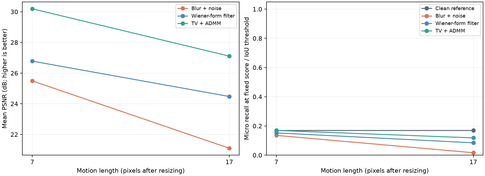

# RoboVision Restore

**Does recovering a sharper image help a robot's object detector?**

An explainable computational-imaging project with a self-contained Google Colab notebook. It connects a known-kernel inverse problem to household-object detection. The first experiment runs on ordinary COCO images; an optional second notebook collects robot-view images from AI2-THOR.

[](https://colab.research.google.com/github/yuweimin2077-hub/robovision-restore/blob/main/notebooks/01_start_here.ipynb)
[](https://github.com/yuweimin2077-hub/robovision-restore/actions/workflows/tests.yml)

## Start here

1. Open the [main tutorial in Colab](https://colab.research.google.com/github/yuweimin2077-hub/robovision-restore/blob/main/notebooks/01_start_here.ipynb).
2. Select **File -> Save a copy in Drive** if you want to keep your changes. Alternatively, upload `notebooks/01_start_here.ipynb` through **File -> Upload notebook**.
3. Select **Runtime -> Run all**. CPU works; a GPU is optional for the detector.
4. Read the explanations between cells. Download the results ZIP from the last cell.

The notebook includes the project source and a tiny annotation manifest. You do not need to publish a GitHub repository or upload additional code. It downloads six images in quick mode and an approximately 13 MB official detector checkpoint. It does not train a model or require API keys. Runtime depends on Colab availability and the assigned hardware.

**Before presenting:** read `docs/EXPLAIN_IT.md`, then rehearse with `docs/PRESENTATION_GUIDE.md`. See `examples/verified_run/` for a recorded local CPU run, including actual results and environment details. Local verification is not a claim that a hosted Colab session has been executed.

## The experiment in one picture

```text
Clean image x
    |
    | Known motion blur H + Gaussian noise n
    v
Observed image y = Hx + n
    |                         |
    | Wiener-form filter      | Total variation + ADMM
    v                         v
Restored image A          Restored image B
    |                         |
    +---- same frozen object detector ----+
                      |
          Compare image quality AND detection
```

Four conditions are compared: clean reference, degraded observation, Wiener-form restoration, and TV-ADMM restoration. Clean images are a reference condition, not guaranteed to yield the best detector result on every example.

## What is implemented

| Component | What it does |
|---|---|
| Image formation | Straight-line motion PSF and additive Gaussian noise |
| Fast baseline | Wiener-form filter with a constant Tikhonov regularizer |
| Course method | Isotropic TV regularization solved with ADMM and FFTs |
| Frozen detector | Torchvision SSDLite320 MobileNetV3, COCO_V1 weights |
| Fair comparison | Development-only parameter selection; held-out test images; identical noise across methods |
| Image metrics | PSNR and SSIM on a fixed interior crop |
| Detection metrics | Class-aware, one-to-one precision and recall at score 0.3 and IoU 0.5 |
| Outputs | CSV tables, parameter choices, convergence traces, all-example gallery, predictions, environment record |
| Robot-view extension | AI2-THOR collection with simulator ground truth and scene-disjoint splits |

The detection score is **not COCO mAP**. The project currently evaluates perception; it does not train a robot policy or measure navigation success.

## Recorded pilot result

The [full pilot](examples/verified_run/full/RESULTS.md) uses 6 development and 12 held-out images. At 17-pixel blur, TV-ADMM raises mean PSNR from **21.10 to 27.11 dB** and correct detections from **1/59 to 7/59**. The clean-image detector finds **10/59**, so the result shows partial recovery with substantial detector limitations. This small controlled study is not evidence of real-robot task success.



Read the [recorded-run explanation](examples/verified_run/README.md) for counts, assumptions, and reproducibility files.

## Data and scope

The manifest contains 18 COCO validation images: 6 development and 12 test images. Selection is deterministic and annotation-based: each image contains a cup or bowl of at least 30 pixels at a 384-pixel long side. Selected-category crowd images are excluded. All annotations in the five evaluation categories are retained: bottle, cup, bowl, chair, and book. Selection does not use detector performance. Image-level splitting is not proof of scene independence for COCO.

Quick mode uses the first 2 development and first 4 test images. Full pilot mode uses all 18. Both are small pilot experiments, not final benchmarks. Original image URLs, annotation IDs, image licenses, and the annotation-file hash are retained in `data/coco_household18.json`.

For actual simulated robot views, open the [robot-view notebook in Colab](https://colab.research.google.com/github/yuweimin2077-hub/robovision-restore/blob/main/notebooks/02_robot_views.ipynb) in a **Linux Colab GPU runtime**. That notebook requires the AI2-THOR simulator and working GPU graphics support. Its rendering path must be checked on the assigned runtime. It is separate so a graphics setup failure cannot block the main imaging experiment.

## Local use

Use Python 3.10 or newer in a virtual environment:

```bash
python -m pip install -r requirements.txt
python -m pip install torch torchvision
python -m robovision.experiment
```

For a larger pilot or an imaging-only run:

```bash
python -m robovision.experiment --full --output runs/full
python -m robovision.experiment --no-detection --output runs/imaging_only
python -m robovision.experiment --manifest data/ai2thor/manifest.json --full --output runs/robot_views
```

The detector uses the installed compatible torch/torchvision pair. Colab setup preserves its preinstalled pair. Version ranges express supported intent; `examples/verified_run/environment.json` records the exact versions actually tested. Reproduction across different hardware or library versions may differ slightly.

## Repository map

```text
notebooks/01_start_here.ipynb    Main tutorial and full experiment
notebooks/02_robot_views.ipynb   Optional simulator data collection
robovision/imaging.py           Forward model and inverse solvers
robovision/experiment.py        Development tuning and test evaluation
robovision/metrics.py           Quality metrics and box matching
robovision/ai2thor_data.py       Simulator labels and data collection
docs/EXPLAIN_IT.md              Plain-language explanation with the math
docs/PRESENTATION_GUIDE.md      18-minute outline, speaker notes, and Q&A
docs/EXPERIMENT_PLAN.md         Course milestones and next experiments
tests/test_science.py           Operator, restoration, split, and metric tests
tools/build_notebooks.py        Rebuild self-contained notebooks from source
```

## Assumptions you should state in class

- The blur kernel is known. This is non-blind deblurring.
- Convolution is spatially invariant and circular. It approximates camera motion; it does not model depth-dependent motion or rolling shutter.
- Noise is Gaussian in normalized RGB space. This is not a calibrated raw-camera noise model.
- The observation is not clipped before restoration, preserving the stated linear model. Display, detection, and quality evaluation clip outputs to [0, 1].
- PSNR and SSIM exclude a border; the detector sees the full image. Periodic boundary artifacts can still affect detection.
- Restoring pixels and recognizing objects are different objectives. Higher PSNR need not imply higher recall.
- The current COCO pilot does not establish real-robot benefits. AI2-THOR also introduces a domain gap for a COCO-trained detector.

## Course connection

This project studies inverse problems, regularization, optimization, ADMM, and image restoration. It follows the supplied EN.520.658/458 syllabus: a one-page proposal, up to two-page progress report, up to four-page final report, and a 15-20 minute presentation. Final submissions must use the instructor's LaTeX template. The template has not been supplied; these Markdown learning notes are not a formatted course submission.

## Verification and license

```bash
python -m pip install -r requirements-dev.txt
python -m pytest -q
python tools/build_notebooks.py
```

Code is under the MIT license. Dataset images, annotations, model weights, and simulator assets retain their original terms; see `THIRD_PARTY.md`. Downloaded datasets, weights, virtual environments, and generated runs are excluded from Git.
